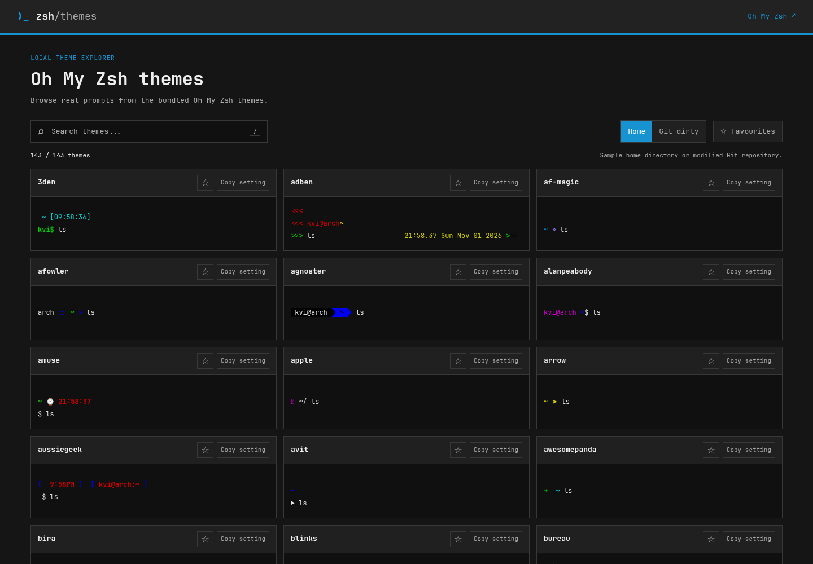

# Oh My Zsh Theme Viewer

**Live:** [ohmyzsh-theme.vercel.app](https://ohmyzsh-theme.vercel.app)

A visual gallery of every bundled [Oh My Zsh](https://ohmyz.sh/) theme. Each preview is rendered from the theme's real prompt by Zsh, not a static screenshot, so you can see the colours, symbols and Git status before changing `ZSH_THEME`.

## Highlights

- **143 themes** rendered from a pinned Oh My Zsh snapshot
- **Home and Git-dirty modes** to compare prompts in different contexts
- **Search, favourites and one-click copy** of the `ZSH_THEME` setting
- **Arch-inspired interface** set in JetBrains Mono Nerd Font for full icon support
- **Static and self-contained**: plain HTML, CSS and JavaScript, no build step

## Attribution

Oh My Zsh themes and runtime: [MIT licence](vendor/ohmyzsh/LICENSE.txt), snapshot [`2100c630`](https://github.com/ohmyzsh/ohmyzsh/tree/2100c630ba4bd67bb48802c3e7da893a4fdaa1a0). JetBrains Mono Nerd Font: [SIL Open Font Licence](fonts/OFL.txt).
